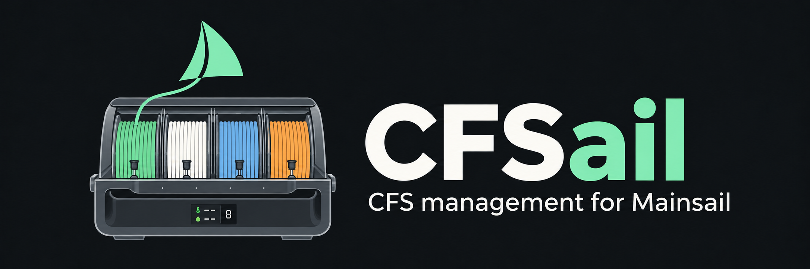
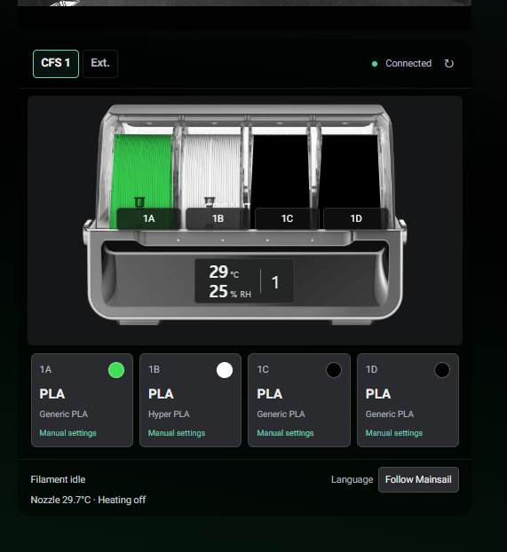
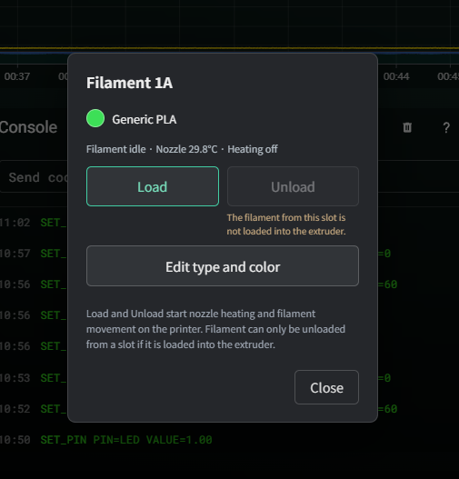
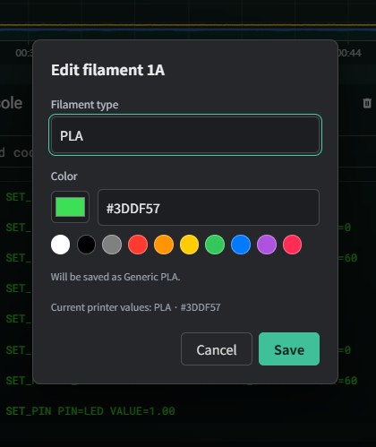
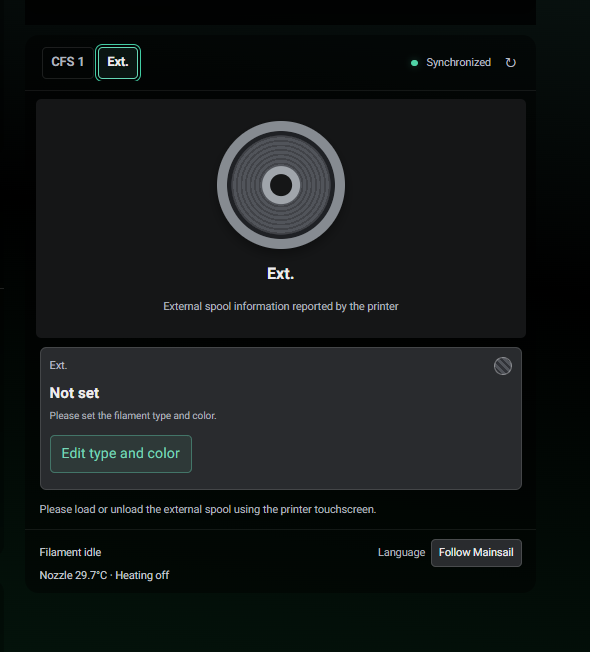
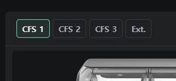
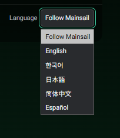
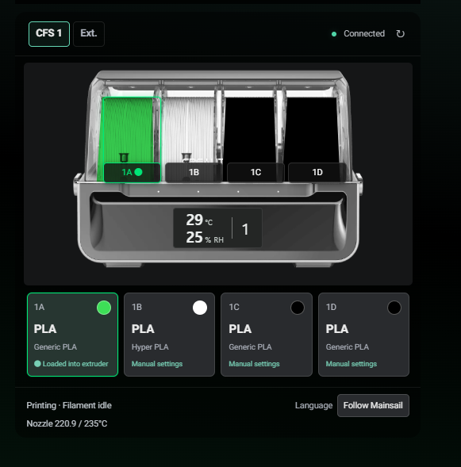
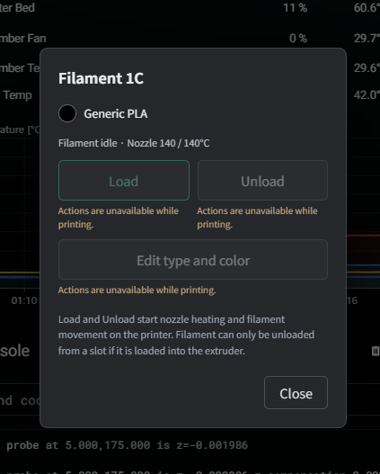

# CFSail

**Mainsail-CFS-Panel**은 메인세일에서 Creality CFS와 외부 스풀의 필라멘트 정보를 관리하는 프로젝트입니다. 패널 이름은 **CFSail**입니다.

현재 버전은 **v0.1.0 베타**입니다. K2 Plus와 Creality Hi에 실제로 설치해 확인했으며, 프린터의 Creality 통신 인터페이스와 메인세일 빌드에 따라 호환성이 달라집니다.

상단 CFS 탭을 선택하면 해당 장치의 종류·색상·익스트루더에 로딩된 필라멘트·온습도가 표시됩니다. 외부 스풀의 탭과 이름은 모든 언어에서 `Ext.`로 표시합니다. 프린터가 편집 가능으로 보고하는 필라멘트는 Generic 재질과 색상으로 수정하고, 저장 후 프린터 응답에서 적용 여부를 확인합니다. 외부 스풀 로딩·언로딩은 프린터 터치스크린에서 진행합니다.

실제 프린터에 연결하면 **CFS 내부 온도(°C)와 상대습도(% RH)를 표시합니다.** CFS가 측정해 프린터로 전달한 값을 사용하며, 연결 중에는 측정값을 주기적으로 갱신합니다.

설치 안내와 패널은 **영어·한국어·일본어·중국어 간체·스페인어, 총 5개 언어**를 지원합니다. 언어 메뉴의 기본값인 ‘Mainsail 언어 따라가기’는 메인세일의 언어와 동기화됩니다. 직접 언어를 고르면 그 선택을 우선하며, 다시 ‘따라가기’를 선택하면 자동 동기화가 재개됩니다. 선택 모드는 프린터 주소별로 해당 브라우저에 저장됩니다. 메인세일 자체와 터치스크린의 언어는 바꾸지 않습니다.

## 사용 예시

| CFS 정보 | 필라멘트 동작 메뉴 |
| --- | --- |
|  |  |
| 슬롯별 종류·색상, 실제 CFS 내부 온도(°C)·상대습도(% RH)와 프린터 상태를 확인합니다. | 슬롯을 선택해 로딩·언로딩·수정을 실행합니다. 사용할 수 없는 동작은 이유를 표시합니다. |

| 종류·색상 수정 | 외부 스풀 |
| --- | --- |
|  |  |
| 종류와 색상을 선택하고 프린터의 Generic 재질값으로 저장합니다. | **Ext.** 탭에서 프린터가 보고한 외부 스풀 정보를 확인하고 종류·색상을 수정합니다. |

| 다중 CFS 선택 | 언어 메뉴 |
| --- | --- |
|  |  |
| 감지된 CFS 사이를 전환합니다. 사진은 CFS 3개를 표시한 예시 화면입니다. | 메인세일 언어를 따라가거나 다섯 언어 중 하나를 직접 선택합니다. |

### 실제 출력 중 사용 화면

| 로딩된 필라멘트와 실시간 상태 | 출력 중 동작 제한 |
| --- | --- |
|  |  |
| 익스트루더에 로딩된 것으로 보고된 **1A** 슬롯을 초록색으로 강조합니다. 하단에는 출력 상태와 노즐의 현재·목표 온도를 표시합니다. | 출력 중에는 **로딩·언로딩·종류와 색상 수정**을 비활성화하고, 각 동작 아래에 제한 이유를 표시합니다. |

## 설치

[**v0.1.0 릴리즈**](https://github.com/military-cat/Mainsail-CFS-Panel/releases/tag/v0.1.0)의 [**Mainsail-CFS-Panel-v0.1.0.zip**](https://github.com/military-cat/Mainsail-CFS-Panel/releases/download/v0.1.0/Mainsail-CFS-Panel-v0.1.0.zip)을 사용합니다. 빌드된 패널과 번역이 포함된 버전별 설치 패키지입니다.

Python 3.8 이상, 이미 설치된 메인세일, 포트 9999의 Creality WebSocket 서비스가 필요합니다. 아래 SSH 다운로드 명령에는 `wget`과 `unzip`도 필요합니다. 프린터에 Node.js를 설치할 필요는 없습니다.

PC의 터미널에서 기존 SSH 계정으로 접속합니다. `PRINTER_IP`를 프린터 주소로 바꿔 주세요. 아래 예시는 `root` 계정입니다.

```sh
ssh root@PRINTER_IP
```

접속한 뒤 **프린터의 SSH 터미널에서** 다음 명령을 실행합니다. v0.1.0 설치용 ZIP을 내려받아 별도 준비 폴더에 압축을 풀고 설치기를 실행합니다. 중간 단계가 실패하면 `&&`에서 멈춥니다.

```sh
mkdir -p /mnt/UDISK/cfsail-install-v0.1.0 &&
cd /mnt/UDISK/cfsail-install-v0.1.0 &&
wget -O Mainsail-CFS-Panel-v0.1.0.zip https://github.com/military-cat/Mainsail-CFS-Panel/releases/download/v0.1.0/Mainsail-CFS-Panel-v0.1.0.zip &&
unzip -o Mainsail-CFS-Panel-v0.1.0.zip &&
cd Mainsail-CFS-Panel &&
sh install.sh
```

`wget`이 없고 `curl`을 사용할 수 있다면 위 명령의 `wget -O`를 `curl -fL -o`로 바꿔 주세요. 다운로드 주소와 줄 끝의 `&&`는 그대로 둡니다.

프린터에서 직접 다운로드하거나 `unzip`을 실행할 수 없다면 PC에서 설치용 ZIP을 내려받아 압축을 풀고, `Mainsail-CFS-Panel` 폴더 전체를 SCP/SFTP로 프린터에 옮깁니다. 프린터의 SSH 터미널에서 해당 폴더로 이동해 실행합니다.

```sh
sh install.sh
```

언어 선택 → 메인세일 위치·호환성 검사 → 변경 파일 안내 → 확인 → 백업 후 설치 순서입니다.
알려진 K2 설치 경로에서는 `/mnt/UDISK/cfsail-backups`에 원본을 보관합니다. 위치를 자동으로 확인할 수 없으면 `--web-root`와 웹 루트 밖의 `--backup-dir`을 지정합니다.

설치 전 계획만 확인하려면:

```sh
sh install.sh --lang ko --web-root /usr/share/mainsail --dry-run
```

업데이트하거나 설치 안내·대체 기본 언어를 바꾸려면 다음과 같이 실행합니다. 패널 언어는 화면의 메뉴에서 바로 바꿀 수 있습니다.

```sh
sh install.sh update --lang ko --web-root /usr/share/mainsail
```

제거하고 설치 전 메인세일로 복원하려면:

```sh
sh install.sh uninstall --lang ko --web-root /usr/share/mainsail
```

별도 백업 경로를 지정했다면 모든 작업에서 같은 경로를 사용합니다. 수정된 관리 파일이나 손상된 백업이 발견되면 덮어쓰기를 거절합니다. 설치기는 **프린터 컨픽 수정, 서비스 설치·재시작, 재부팅, 필라멘트 이동을 하지 않습니다.**

## 배치와 호환성

- `--layout auto`: 검증된 빌드에서는 메인세일 기본 대시보드 배치에 등록하며, 지원하지 않는 빌드에서는 고정 배치를 안내합니다.
- `--layout native`: 기본 배치를 지원하지 않는 빌드에서는 변경 없이 종료합니다.
- `--layout standalone`: 새로운 기본 배치 패치를 추가하지 않습니다. 이미 설치된 호스트는 보존합니다.

기본 배치 패치는 확인한 Mainsail 2.19.0 빌드의 연결 지점에 한정됩니다. 메인세일 업데이트로 연결이 교체될 수 있습니다. 자세한 설치·복구 방법은 [설치 문서](docs/INSTALLATION.md)를 참고해 주세요.

## 예시 화면

개발용 PC에서 Node.js 22 이상으로 실행합니다. 프린터에 설치할 때는 Node.js가 필요 없습니다.

```sh
node demo/server.cjs
```

`http://127.0.0.1:8788/`에서 다섯 언어의 화면을 확인할 수 있습니다. 여기서의 저장과 로딩·언로딩은 모의 데이터에만 적용됩니다.

코드는 GPL-3.0-only로 제공하며 원본 프로젝트와 이미지의 권리는 [NOTICE.md](NOTICE.md)에 기록했습니다.
